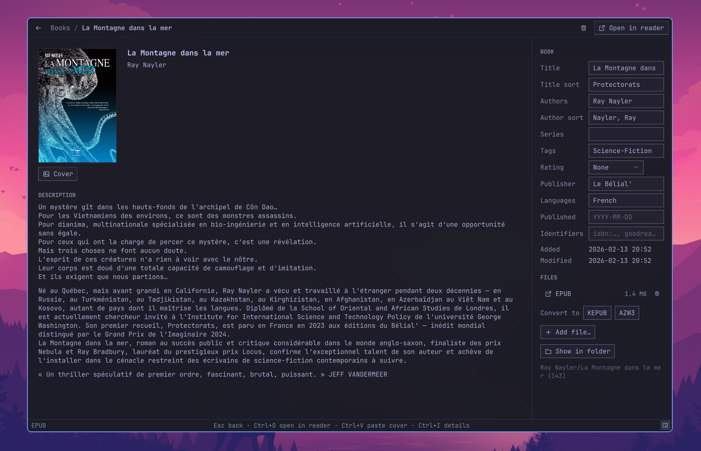

<a id="readme-top"></a>

<div align="center">

<pre>
─────────────────────────────
    C  O  U  S  O  I  R    

</pre>

# 📚 Cousoir

### *Your Calibre library, beautifully bound*

Browse, edit and grow your Calibre library in a fast, Omarchy-first app,<br/>
then send your books to a Kobo or a Kindle. Calibre stays in charge, and both always agree.

<br/>



<br/>

✨ [Features](#-features) • ⚡ [Installation](#-installation) • 🚀 [Getting started](#-getting-started) • 🤝 [Calibre stays in charge](#-calibre-stays-in-charge) • 🔒 [Your library stays safe](#-your-library-stays-hopefully-safe) • 🎨 [Made for Omarchy](#-made-for-omarchy) • 💛 [Built on Calibre](#-built-on-calibre) • 🔧 [For developers](#-for-developers)

</div>

---

## ✨ Features

- 📚 **Your Calibre library, as it is.** Cousoir opens the library Calibre
  opens and works on Calibre's own `metadata.db`. Nothing to import, no second
  database.
- 🖼️ **A table or a wall of covers.** Pick the columns, custom ones
  included, and sort by any of them in Calibre's own order: *Le Petit
  Prince* files under "Petit Prince, Le". Each library keeps its columns,
  Calibre's at first.
- 🔍 **Search like Calibre.** Calibre's own search language, `tag:sf
  rating:>=4 not author:vian`, templates included, finding exactly the
  books Calibre finds, with
  your saved searches in the sidebar and your virtual libraries a click
  away. Or browse by author, series, tag, language and publisher.
- ✏️ **Edit in place.** Title, authors, series, tags, rating, publisher,
  languages, dates, identifiers and your custom columns save as you leave
  the field, and composite columns compute as in Calibre; the description edits as text, with **bold**, *italics*, lists
  and links.
  Drop or paste an image to change the cover.
- 📚 **Many books at once.** Select with Ctrl, Shift or Ctrl+A, then trash,
  convert, send, or edit them together as Calibre's bulk edit does: tags
  added and removed, a series numbered, and Undo if you change your mind.
- ➕ **Add books by dropping them.** Files or whole folders. Their metadata,
  custom columns included, is read as Calibre reads it, and Cousoir asks
  before adding a book you already have.
- 🗑️ **A trash shared with Calibre.** Books and files go to the library's own
  trash and come back with Restore, from Cousoir or from Calibre.
- 🩺 **A check-up for your library.** The Check section finds the same book
  added twice, an author filed under several names, books whose files are
  gone and files the database doesn't know. Keep one copy, merge the names or
  tidy the entries in a click, or ignore what you meant.
- 🌐 **Metadata and covers from the web.** Calibre's own sources look the
  book up, or Open Library when Calibre isn't installed; pick the fields to
  take beside your values, and a cover among those found. Revert undoes it.
- 🔄 **Convert for your reader.** KEPUB for a Kobo, AZW3 for a Kindle, with
  Calibre and your conversion settings. Without Calibre, Cousoir makes the
  KEPUB of an EPUB itself.
- 📲 **Send to your Kobo or Kindle.** Plug it in and press Ctrl+D. Books land
  exactly where Calibre puts them, and each app recognises the books the other
  sent. Neither needs Calibre: Cousoir makes a Kobo's KEPUBs and writes a
  Kindle book's metadata itself.
- 📖 **Read in Cousoir.** EPUBs and Kindle books (AZW3, MOBI, without
  Calibre) a page or two at a time, or as a scroll,
  at a line length that reads well, in the font, spacing and colours you
  like (sepia and black included), the time left in the chapter and the
  book at your pace; their table of contents, a search of the whole book,
  notes shown by their links and pictures zoomed, words looked up in
  Wiktionary or Wikipedia beside the page; highlights in five colours with your notes, and
  bookmarks; the book read aloud by your system's voices; full screen;
  and PDFs.
  Your place and your highlights are kept
  where Calibre's viewer keeps its own: each opens where the other stopped
  and shows the other's highlights.
- 🔎 **All your highlights in one place.** The books you highlighted in
  Cousoir's reader, Calibre's viewer or on your Kobo, each one's highlights
  and notes typeset as a page by chapter, as kbextract2 shows them, and
  copied as Markdown, Obsidian Markdown or plain text.
- 🖍️ **Your Kobo's highlights, at their place in your books.** Plug it in:
  its highlights and notes go into the library, each where you made it in
  the book, for Calibre's search and Cousoir's reader, and those you delete
  on the Kobo go too. A copy of its database will do, and the books the
  library hasn't still show.
- 📈 **Your reading, back from the Kobo and the Kindle.** How far you got in
  each book on a Kobo, and a Kindle's highlights from "My Clippings", by
  book, copied or saved as Markdown, still there once the reader is
  unplugged.
- 🛡️ **Safe, shared or not.** Cousoir writes only when nothing else can:
  Calibre closed and, for a library in Dropbox, Syncthing, Nextcloud or on a
  network folder, no other computer editing.
- 🎨 **Wears your Omarchy theme**, or follows your system's light or dark
  mode.
- ⌨️ **Keyboard-first.** Every action has a shortcut, the status bar shows
  the ones that matter right now, and Ctrl+K finds any book, author, series,
  tag, section or action by a few letters.
- 🧰 **A command line, too.** `cousoir-cli` lists and searches a library
  exactly as `calibredb list` and `calibredb search` do, checks its health,
  applies changes from a JSON file, and makes KEPUBs.

<div align="right"><a href="#readme-top">↑ back to top</a></div>

---

## ⚡ Installation

On Arch Linux and Omarchy:

```bash
sudo pacman -S --needed base-devel cmake qt6-base qt6-declarative qt6-svg qt6-webengine qt6-speech sqlite libzip icu libstemmer xxhash libmtp calibre
git clone https://github.com/314r/cousoir.git
cd cousoir
make install
```

On other distributions, you need Qt 6.9 or later, SQLite, libzip, ICU, Snowball's libstemmer, xxHash, CMake 3.21
or later and a C++20 compiler; libmtp for a Kindle; Qt WebEngine for the
reader, Qt TextToSpeech and speech-dispatcher to read aloud. [DOC.md](DOC.md)
has the details.

> **About Calibre:** Cousoir browses and edits a library, sends to a Kobo
> or a Kindle, downloads metadata and reads books on its own. Calibre
> itself converts to AZW3, downloads metadata from its own sources, and reads
> the metadata of formats other than EPUB, KEPUB, MOBI, AZW3 and PDF: install
> it too if you need those.

Cousoir installs under `~/.local` and appears in your app launcher. Set
`PREFIX` to install it somewhere else.

<div align="right"><a href="#readme-top">↑ back to top</a></div>

---

## 🚀 Getting started

1. **Have a Calibre library.** Cousoir opens the one Calibre opens on this
   computer. None yet? Cousoir asks for its folder on first launch. Another
   one? Pick it in Settings, under Library.
2. **Open Cousoir.** Your books appear as a table. Press Ctrl+G for covers,
   Ctrl+F to search.
3. **Open a book** with Enter. Edit its details in the pane on the right; each
   change saves as you leave the field.
4. **Plug in your Kobo or Kindle.** It shows up in the sidebar. Select a book
   and press Ctrl+D to send it.

> **Tip:** a lock in the status bar means the library is read-only right now,
> because Calibre is open, Dropbox is syncing or another computer just changed
> the library.
> Click it to see why.

<details>
<summary>⌨️ Keyboard shortcuts</summary>

<br/>

| Shortcut | Action |
|---|---|
| Enter, Space, double click | Open the book, or the section's item |
| Menu, Shift+F10, right click | Book actions: open, open in reader, show folder, convert, send, move to trash |
| Ctrl+N | Add books |
| Ctrl+Shift+K, Ctrl+Shift+A | Convert the book to KEPUB or AZW3 |
| Ctrl+D | Send the book to the reader plugged in |
| Ctrl+click, Shift+click, Ctrl+A | Select several books, to act on or edit together |
| Del | Move the selected books to the trash, or remove a book from the reader |
| Ctrl+O | Open the book in your ebook reader |
| Ctrl+Shift+O | Read the book in Cousoir |
| Ctrl+G | Show the books as covers or as a table |
| Esc, Alt+Left | Back up one level |
| Ctrl+F | Search |
| Ctrl+K | Find anything: a book, an author, a section, an action |
| F5, Ctrl+R | Reload the library, or read the reader again |
| Ctrl+I | Show or hide the book details pane |
| Ctrl+V | Paste the clipboard's image as the cover |
| Ctrl++, Ctrl+-, Ctrl+0 | Text size |

</details>

<div align="right"><a href="#readme-top">↑ back to top</a></div>

---

## 🤝 Calibre stays in charge

Cousoir is a companion to Calibre, not a replacement. Calibre keeps owning the
library and keeps working exactly as before.

- **Same rules, same results.** Wherever Cousoir computes something Calibre
  computes (title sorts, author sorts, folder and file names, `metadata.opf`
  files), it follows Calibre's own code, ported from Calibre's source.
- **Checked against Calibre itself.** The tests run Calibre and Cousoir side
  by side on the same libraries and compare every table, every file and every
  cover. `cousoir-cli list` matches `calibredb list` byte for byte.
- **Calibre does the heavy lifting.** When Calibre is installed, conversions,
  transfers to readers and metadata downloads run Calibre's own converters,
  device drivers and sources, with your settings.
- **Never in each other's way.** While Calibre is open, Cousoir only reads;
  while Cousoir saves, Calibre can't start.

The few places where Cousoir departs from Calibre on purpose are listed in
[DOC.md](DOC.md).

<div align="right"><a href="#readme-top">↑ back to top</a></div>

---

## 🔒 Your library stays (hopefully) safe

- **Never opened in place.** Cousoir reads a copy of `metadata.db`, so your
  sync service has nothing to sync and Calibre nothing to notice.
- **Backed up first.** Before its first change in a session, Cousoir copies
  the database to `~/.local/share/cousoir/backups/` and keeps the last 30
  copies.
- **Crash-proof saves.** Every change is journaled. After a crash, the next
  start either rolls it back or finishes it, and tells you which.
- **Sync-aware.** In Dropbox, Syncthing, Nextcloud or ownCloud, or on a
  network folder, fresh changes, conflict copies and another computer editing
  keep the library read-only until it is safe to write, and so do Dropbox's
  syncs in progress. For OneDrive, Google Drive and the like, say so in the
  library settings. A library only this computer changes is ready as soon as
  Calibre closes.
- **Hands off your Kobo's database.** Cousoir only reads it.
- **Nothing leaves your computer.** No accounts, no telemetry; the web only
  when you download a book's metadata and covers.

<div align="right"><a href="#readme-top">↑ back to top</a></div>

---

## 🎨 Made for Omarchy

Cousoir follows the Omarchy style: your monospace font, square corners,
hairline dividers, and one accent color per screen. With the Omarchy theme it
reads its colors from `~/.local/state/omarchy/current/theme/colors.toml` and
repaints a moment after you switch themes, with no restart.

Not on Omarchy? Pick the system, light or dark theme in Settings, and the text
size that suits you.

<div align="right"><a href="#readme-top">↑ back to top</a></div>

---

## 💛 Built on Calibre

Cousoir would not exist without **[Calibre](https://calibre-ebook.com)**, the
free and open-source ebook manager created by **Kovid Goyal** and built with
the Calibre contributors. Much of Cousoir is Calibre's own work, ported from
Python to C++:

- 🔤 **the rules for title sorts, author sorts, and folder and file names**,
  and the transliteration table behind them;
- 🗃️ **the way changes are written to the library**: the field writers, new
  books, formats and the trash;
- 📖 **the metadata readers** for OPF 2 and 3, EPUB, MOBI, PDF and XMP, and
  the `metadata.opf` writer;
- 🔍 **the search language, the template language and the sort order**, so
  that a search, a composite column or a sorted list come out as in Calibre;
- 🖍️ **the reading positions and highlights** of Calibre's viewer, and the
  CFIs it places them by, and the notes Calibre keeps on authors, series,
  tags and publishers;
- 📲 **how books are sent to a Kobo or a Kindle**, found there and matched
  with the library, from Calibre's device drivers, and how a KEPUB is made,
  from its kepubify. The Kobo driver is the work of Timothy Legge, Kovid
  Goyal and David Forrester.

And when Cousoir converts a book or sends it to a reader, Calibre itself does
the work. [CREDITS.md](CREDITS.md) lists every piece of Calibre in Cousoir,
file by file, with its authors.

If Cousoir is useful to you, please
**[support Calibre](https://calibre-ebook.com/donate)**.

> Cousoir is an independent project, not made, endorsed or supported by the
> Calibre project. Please report Cousoir's bugs here, not to Calibre.

Thanks also to Hiroshi Miura and John Schember for Unihandecode, and to Sean
M. Burke for Text::Unidecode, which it grew from; to Grant Drake, whose Find
Duplicates plugin gave the Check section its idea; to
[kbextract](https://github.com/314r/kbextract) and JolieBulle, where Cousoir's
structure, theming and Settings window come from; to
[kbextract2](https://github.com/314r/kbextract2), whose way with a Kobo's
highlights Cousoir follows; to bjarneo's
[omadji](https://github.com/bjarneo/omadji), where its Omarchy theming comes
from; to [Omarchy](https://omarchy.org) for the look; to [Lucide](https://lucide.dev)
for a few icons; and to Qt, SQLite, libzip, ICU, Snowball, xxHash, libmtp and
poppler.

<div align="right"><a href="#readme-top">↑ back to top</a></div>

---

## 🔧 For developers

Cousoir is written in C++20 with Qt 6 and QML. [DOC.md](DOC.md) covers
everything in detail: each screen, how a change is saved, `cousoir-cli`, the
requirements, the build, and the tests, which run Calibre as the reference
for every result.

<div align="right"><a href="#readme-top">↑ back to top</a></div>

---

## 📜 License

Cousoir is free software, released under the
[GNU General Public License, version 3](LICENSE), because it contains code
ported from Calibre, which is GPL v3. The theme files that come from
kbextract, JolieBulle and omadji, and the Kobo highlights code that comes
from kbextract2, also keep their [MIT notice](LICENSES/MIT.txt), and the
icons adapted from Lucide their [ISC notice](LICENSES/ISC-lucide.txt).

---

<div align="center">

📖 🪡 📖

### 💛 Bound with Qt, built on Calibre, and colored by your Omarchy theme.

</div>
